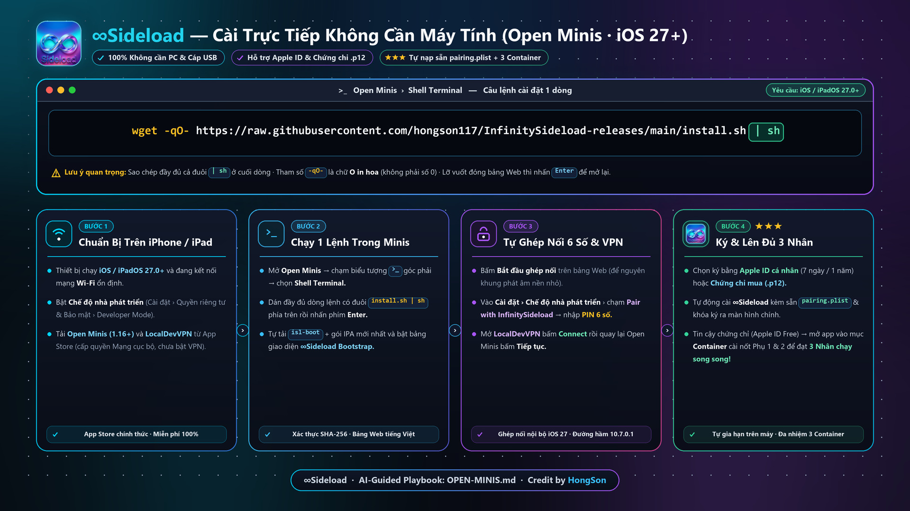

# 📱 Cài Đặt ∞Sideload Trực Tiếp Trên iPhone / iPad Không Cần Máy Tính (Open Minis · iOS 27+) & AI Playbook

> **Kho phân phối công khai chính thức:** <https://github.com/hongson117/InfinitySideload-releases>  
> Tài liệu này được thiết kế chuẩn **AI-Guided Playbook** để bất kỳ người dùng nào cũng có thể **tự cài đặt trong 3 phút** hoặc **sao chép đường dẫn này gửi cho AI (ChatGPT, Gemini, Claude, Grok, Perplexity, hoặc AI tích hợp ngay trong Open Minis)** để được hướng dẫn cầm tay chỉ việc từng bước.



---

## 🤖 Cách Nhờ AI Hướng Dẫn Từng Bước (Dành Cho Người Dùng)

Bạn chỉ cần sao chép nguyên đoạn văn bản dưới đây và dán vào **ChatGPT / Gemini / Claude** (hoặc khung chat AI của **Open Minis**):

```text
Hãy đọc tài liệu chính thức tại https://raw.githubusercontent.com/hongson117/InfinitySideload-releases/main/OPEN-MINIS.md và hướng dẫn tôi cài đặt ∞Sideload trực tiếp trên iPhone/iPad không cần máy tính. Hãy hỏi phiên bản iOS của tôi trước, sau đó hướng dẫn tôi làm từng bước một thật ngắn gọn, chờ tôi báo xong bước này mới sang bước tiếp theo.
```

---

## 🧭 Giao Thức Dành Cho AI Hỗ Trợ Người Dùng (AI Coaching Protocol)

Nếu bạn là **AI Assistant / AI Agent** đang đọc tài liệu này để hỗ trợ người dùng cài đặt **∞Sideload**, **BẮT BUỘC** tuân thủ đúng quy trình sau:

### Quy tắc Bảo mật & Tương tác Bắt buộc
1. **Hỏi phiên bản iOS / iPadOS đầu tiên** trước khi đưa lệnh:
   - **Nếu máy chạy `iOS / iPadOS 27.0 trở lên`:** Đủ điều kiện cài đặt **100% không cần máy tính** qua **Open Minis** bên dưới.
   - **Nếu máy chạy `iOS / iPadOS 17.4 – 26.x` (ví dụ `18.6.2`):** Giải thích rõ cho người dùng rằng tính năng *Tự ghép nối không cần máy tính (`Pair with InfinitySideload` ở cuối trang Developer Mode)* là cơ chế Apple **chỉ mở từ iOS 27.0 trở lên**. Trên iOS 17.4–26.x, hãy hướng dẫn người dùng chuyển sang **Bộ cài cáp USB 1 lần trên Windows/Mac** tại [`README.md`](README.md) (hoặc ký cài OTA nếu họ đã mua chứng chỉ `.p12` gắn UDID máy đó).
2. **Hướng dẫn từng bước một (One Step at a Time):** Không đổ dồn toàn bộ bài dài vào một tin nhắn. Sau mỗi bước, chờ người dùng xác nhận *"Xong"* hoặc gửi ảnh màn hình rồi mới chuyển sang bước kế tiếp.
3. **Nhắc kiểm tra đuôi ` | sh`:** Khi người dùng sao chép lệnh `wget`, rất hay bị thiếu đoạn ` | sh` ở cuối (khiến màn hình chỉ in ra nội dung chữ `#!/bin/sh...` mà không chạy). Nếu người dùng gửi log thấy `#!/bin/sh`, hãy báo ngay họ dán thiếu ` | sh` ở cuối dòng.
4. **Tuyệt đối bảo mật thông tin nhạy cảm:** **KHÔNG BAO GIỜ** yêu cầu người dùng nhắn mật khẩu Apple ID, mã 2FA, mật khẩu `.p12` hay tệp chứng chỉ vào khung chat AI. Người dùng chỉ tự gõ trực tiếp vào bảng giao diện cục bộ (`127.0.0.1`) của `isl-boot` bên trong ứng dụng Open Minis trên máy của họ.

---

## 🚀 Quy Trình Cài Đặt 4 Bước Không Cần Máy Tính (iOS / iPadOS 27+)

### Bước 1: Chuẩn bị trên iPhone / iPad
1. Đảm bảo thiết bị đang chạy **iOS / iPadOS 27.0 trở lên** và đang kết nối **Wi-Fi** ổn định.
2. Bật **Chế độ nhà phát triển (Developer Mode)**:
   - Mở **Cài đặt (Settings) → Quyền riêng tư & Bảo mật (Privacy & Security) → Chế độ nhà phát triển (Developer Mode)** → gạt **Bật** (khởi động lại máy và bấm *Turn On / Bật* nếu vừa bật lần đầu).
3. Tải **2 ứng dụng miễn phí chính thức trên App Store**:
   - [**Open Minis** (phiên bản `1.16` trở lên)](https://apps.apple.com/app/id6759188481)
   - [**LocalDevVPN**](https://apps.apple.com/app/id6755608044)
4. *Lưu ý:* Trong lúc làm Bước 2 (Tải gói & Ghép nối), **tạm thời chưa bật VPN** (để mạng tải GitHub và sóng Bonjour nội bộ thông suốt). Đảm bảo **Open Minis** được cấp quyền **Mạng cục bộ (Local Network)** trong *Cài đặt → Quyền riêng tư & Bảo mật → Mạng cục bộ*.

---

### Bước 2: Chạy 1 Lệnh Cài Đặt Trong Open Minis
1. Mở ứng dụng **Open Minis** → chạm vào biểu tượng **Console / Terminal (`>_`)** ở góc trên bên phải → chọn **Shell Terminal**.
2. Sao chép **đầy đủ cả dòng lệnh dưới đây (bao gồm cả chữ `| sh` ở cuối)**, dán vào Terminal rồi nhấn **Enter**:

```sh
wget -qO- https://raw.githubusercontent.com/hongson117/InfinitySideload-releases/main/install.sh | sh
```

*(Link dự phòng qua CDN jsDelivr nếu mạng nhà bạn chặn `raw.githubusercontent.com`:)*
```sh
wget -qO- https://fastly.jsdelivr.net/gh/hongson117/InfinitySideload-releases@main/install.sh | sh
```

3. Kịch bản sẽ tự động tải công cụ **`isl-boot`**, kiểm tra mã băm bảo mật **SHA-256**, tải gói `Sideload.ipa` mới nhất và **bật bảng giao diện Web tiếng Việt (`∞Sideload Bootstrap`)** ngay bên trong Open Minis.
   - *Mẹo:* Nếu bạn lỡ tay vuốt đóng bảng giao diện Web, chỉ cần **nhấn phím `Enter` ngay trong màn hình Terminal** là bảng Web sẽ bật lại tức thì!

---

### Bước 3: Tự Ghép Nối Thiết Bị & Bật LocalDevVPN
1. Trên bảng giao diện **∞Sideload Bootstrap**, bấm nút **Bắt đầu ghép nối** (cho phép quyền *Thông báo* nếu iOS hỏi).
   - Một trình phát âm thanh nền nhỏ của Open Minis sẽ hiện lên để giữ ứng dụng không bị iOS đóng băng khi chuyển màn hình — **hãy giữ nguyên không tắt trình phát này**, chỉ cần vuốt ra ngoài để mở ứng dụng **Cài đặt** của iPhone.
2. Mở ứng dụng **Cài đặt (Settings)** của iPhone:
   - Vào **Quyền riêng tư & Bảo mật (Privacy & Security)** → **Chế độ nhà phát triển (Developer Mode)**.
   - Kéo xuống **dưới cùng trang**, chạm vào dòng **`Ghép nối với InfinitySideload`** *(hoặc **`Pair with InfinitySideload`**)*.
   - Nhập **mật mã mở khóa màn hình iPhone** của bạn.
   - Nhìn lên biểu ngữ thông báo vừa hiện ở đầu màn hình để lấy **mã ghép nối 6 chữ số** (hoặc mở lại Open Minis xem ô 6 số lớn) → nhập 6 chữ số đó vào ô xác nhận trên màn hình Cài đặt.
3. Sau khi báo đã ghép nối xong, quay lại **Open Minis**:
   - Bấm nút **Mở LocalDevVPN** trên màn hình (hoặc mở ứng dụng **LocalDevVPN** ngoài màn hình chính) → bấm **Connect** để kết nối đường hầm cục bộ `10.7.0.1`.
   - Quay trở lại **Open Minis** và bấm **Đã bật LocalDevVPN — Tiếp tục**.

---

### Bước 4: Chọn Phương Thức Ký & Hoàn Tất Lên Màn Hình Chính
Ngay trên bảng giao diện của `isl-boot`, bạn có thể chọn **1 trong 2 phương thức ký**:

#### Lựa chọn A — Dùng Tài khoản Apple ID cá nhân (Miễn phí 7 ngày hoặc Developer 1 năm)
1. Ở tab **Apple ID cá nhân**, nhập **Email Apple ID** và **Mật khẩu** (dữ liệu chỉ dùng cục bộ trên máy bạn để xác thực với Apple, tuyệt đối không lưu mật khẩu ra đĩa).
2. Bấm **Đăng nhập, Ký & Cài ∞Sideload** → nhập **mã xác thực 2 yếu tố (2FA) 6 chữ số** gửi về máy bạn khi được hỏi.
3. Đợi thanh tiến trình báo **✓ Đã cài đặt ∞Sideload thành công!** (`isl-boot` đã tự động chép sẵn cả `pairing.plist` và khóa ký vào bên trong ∞Sideload).
4. Lần đầu tiên với Apple ID miễn phí: vào **Cài đặt → Cài đặt chung → Quản lý VPN & Thiết bị** → chạm vào tên email Apple ID → bấm **Tin cậy (Trust)**.
5. Bấm **Mở ∞Sideload ngay** → vào tab **Tài khoản** đăng nhập lại Apple ID để bật tự động gia hạn, sau đó bấm biểu tượng **`★`** ở góc phải trên cùng của tab **Ứng dụng** để ứng dụng tự cài đặt nốt 2 Container phụ (**`∞Sideload 1`** & **`∞Sideload 2`** → lên đủ **`★★★`**).

#### Lựa chọn B — Dùng Chứng chỉ mua sẵn (`.p12` + `.mobileprovision` — Hạn 1 năm, không cần Apple ID)
1. Chuyển sang tab **Chứng chỉ mua (.p12)**.
2. Chạm chọn tệp **`.p12`** (hoặc `.pfx`), chọn tệp **`.mobileprovision`** trực tiếp từ ứng dụng *Tệp (Files)* trên iPhone và nhập mật khẩu `.p12`.
3. Bấm **Ký bằng Chứng chỉ & Cài ∞Sideload**.
4. `isl-boot` sẽ ký số và cài thẳng **∞Sideload** ra màn hình chính, đồng thời **tự động nạp sẵn luôn bộ chứng chỉ `.p12` + `.mobileprovision` và file ghép nối vào bên trong ∞Sideload** — mở ứng dụng lên là sẵn sàng cài mọi IPA khác hoặc thêm vào Container ngay lập tức!

---

## 🛠️ Bảng Xử Lý Lỗi Thường Gặp (Troubleshooting Cho Người Dùng & AI)

| Hiện tượng gặp phải | Nguyên nhân | Cách khắc phục ngay |
| :--- | :--- | :--- |
| Chạy lệnh `wget` xong chỉ in ra hàng loạt dòng chữ `#!/bin/sh ...` rồi dừng ở `root@minis:~#` | Khi sao chép lệnh bị thiếu đoạn **` \| sh`** ở cuối dòng | Dán lại đầy đủ cả dòng có đuôi **` \| sh`** ở cuối rồi nhấn Enter (hoặc nếu đã tải lần trước thì chỉ cần gõ thẳng `isl-boot` rồi nhấn Enter). |
| Lỡ tay vuốt mất bảng giao diện Web trong Open Minis | Bảng sheet trình duyệt bị đóng tạm thời | Chỉ cần chạm vào màn hình đen Terminal và **nhấn phím `Enter`**, bảng giao diện Web sẽ bật lên lại đúng bước đang làm dở. (Hoặc chạy `isl-boot --terminal` để thao tác thuần bằng chữ). |
| Vào cuối trang **Developer Mode** không thấy hiện dòng **`Pair with InfinitySideload`** | 1. Máy đang ở iOS dưới 27 (ví dụ iOS 18 / 26)<br>2. Chưa cấp quyền Mạng cục bộ cho Open Minis hoặc tắt Wi-Fi<br>3. Đã bấm tắt khung phát âm thanh nền của Open Minis | 1. Kiểm tra *Cài đặt → Cài đặt chung → Giới thiệu*: nếu iOS `< 27.0`, phải dùng cáp USB 1 lần đầu theo [`README.md`](README.md).<br>2. Bật Wi-Fi, tắt VPN ngoài, bật **Cài đặt → Quyền riêng tư & Bảo mật → Mạng cục bộ → Open Minis**.<br>3. Để nguyên khung phát âm thanh nhỏ khi chuyển sang Cài đặt. |
| Báo lỗi không tải được `Sideload.ipa` hoặc `isl-boot` từ GitHub | Đang bật sẵn `LocalDevVPN` hoặc mạng chặn GitHub | Tạm tắt `LocalDevVPN` trong lúc tải gói ở Bước 2 (hoặc dùng link dự phòng `fastly.jsdelivr.net`), đến Bước 3 khi được nhắc mới bật `LocalDevVPN`. |
| Báo đầy chứng chỉ phát triển (`7460` / `Thu hồi chứng chỉ cũ`) | Apple ID miễn phí chỉ cho phép tối đa 1 chứng chỉ phát triển tại một thời điểm | Trên bảng thông báo hiện ra trong `isl-boot`, bấm chọn thu hồi chứng chỉ cũ để cấp chứng chỉ mới cho chiếc iPhone hiện tại. |
