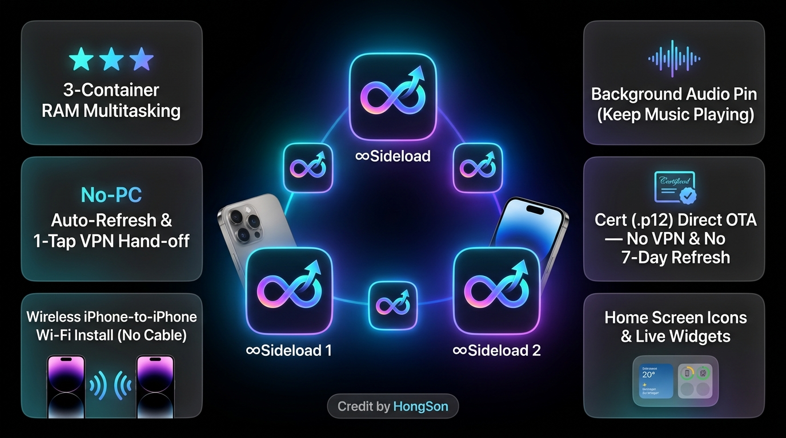
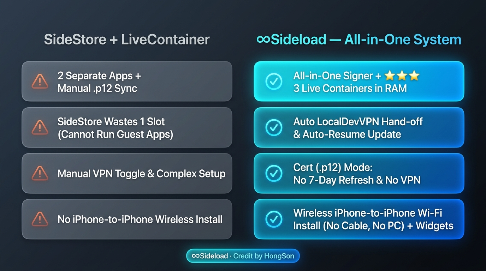

# ∞Sideload (InfinitySideload) — Hướng Dẫn Cài Đặt, Sử Dụng & AI Agent Playbook

**Hệ thống Sideload & Đa Container tự gia hạn không cần máy tính cho iPhone/iPad (iOS/iPadOS 17.4+ & iOS 27).**  
Hỗ trợ đầy đủ song ngữ **Tiếng Việt (`VI`)** và **Tiếng Anh (`EN`)**.  
✨ **Credit by HongSon (`@hongson117`)**



> **Dành cho AI Agent (Codex, Claude Code, Antigravity, Cursor, ChatGPT...):** Tài liệu này được thiết kế chuẩn **AI-Executable README**. Khi người dùng yêu cầu cài đặt, sửa lỗi ghép đôi, tạo icon màn hình chính, giữ phát nền hoặc nâng cấp **∞Sideload**, AI có thể đọc trực tiếp mục **[Phần 1: Giao Thức Thực Thi Dành Cho AI Agent](#-phần-1-giao-thức-thực-thi-dành-cho-ai-agent-ai-execution-playbook)** để tự động chạy lệnh cài đặt qua Terminal/PowerShell hoặc hướng dẫn từng bước chính xác cho người dùng.

---

## ⚡ Vì Sao Chọn **∞Sideload** Thay Vì **SideStore + LiveContainer**?

Trước đây, để vượt giới hạn **3 ứng dụng** của tài khoản Apple ID miễn phí trên iPhone/iPad mà không cần máy tính gia hạn mỗi 7 ngày, người dùng buộc phải ghép nối rời rạc **SideStore** (hoặc AltStore) với **LiveContainer**, kéo theo nhiều thao tác phức tạp: phải cài 2 app riêng biệt, tự xuất/nhập chứng chỉ `.p12` thủ công, mất trắng 1 slot cho SideStore (không chạy được guest app), phải tự bật/tắt VPN thủ công và không thể cài không dây từ iPhone này sang iPhone khác.

**∞Sideload (InfinitySideload)** hợp nhất toàn bộ **Trình ký & Tự gia hạn trên máy (On-Device Signer)** + **Hệ điều hành Đa Container 3 nhân (`1 Chính + 2 Phụ`)** vào **một ứng dụng duy nhất**, tự động hóa từ A–Z.



| Hạng Mục Chức Năng | **∞Sideload (InfinitySideload)** | **SideStore + LiveContainer** |
| :--- | :--- | :--- |
| **1. Kiến trúc Hợp nhất (All-in-One)** | **1 ứng dụng duy nhất**: Tích hợp sẵn lõi ký Apple ID/Chứng chỉ, tự gia hạn 7 ngày, kho nguồn AltStore, cài không dây iPhone-sang-iPhone và bộ chạy Đa Container ngay bên trong. | **2 ứng dụng rời rạc**: Phải cài SideStore trước, tải IPA LiveContainer cài qua SideStore, rồi tự xuất/đồng bộ chứng chỉ `.p12` thủ công. |
| **2. Đa nhiệm 3 nhân thật trong RAM (`★★★`)** | **Tận dụng 100% cả 3 slot Apple ID Free** thành **3 nhân chạy độc lập** (`∞Sideload Chính` + `∞Sideload 1` + `∞Sideload 2`). Mở **3 ứng dụng cùng lúc trên RAM**, vuốt chuyển qua lại trong App Switcher mượt mà không bị đóng hay tải lại! | SideStore chiếm cố định 1 slot (không chạy được guest app). Muốn chạy đa nhiệm phải tự nhân bản & cấu hình `LiveContainer 2` thủ công, rất dễ đụng độ App ID. |
| **3. Tự động điều phối RAM & Giữ nền phát nhạc (`Audio Pin`)** | **Bộ điều phối thông minh**: Tự nhận diện nhân nào đang rảnh để nạp ứng dụng mới mà không tắt ứng dụng đang mở. Tích hợp nút **Giữ nền phát** giúp YouTube, Spotify... phát nhạc liên tục dưới nền và khi khóa màn hình. | Phải tự chọn mở trong container nào; dễ vô tình ghi đè làm văng ứng dụng đang dùng dở. |
| **4. Chế độ Chứng chỉ mua (`.p12` + `.mobileprovision`)** | **Cài đặt OTA trực tiếp**: Tự động ẩn toàn bộ nút/lịch Làm mới 7 ngày và **tuyệt đối không cần mở VPN (`LocalDevVPN`)** khi cài đặt, cập nhật hay quản lý ứng dụng. | SideStore bắt buộc đi qua VPN loopback; muốn cài bằng chứng chỉ mua không VPN phải cài thêm app thứ 3 (ESign / Feather / KSign). |
| **5. Tự động Hand-off `LocalDevVPN` & Tự chạy tiếp khi Cập nhật** | **Luồng 1 chạm thông minh**: Bấm Cập nhật / Làm mới → Tự kiểm tra `LocalDevVPN`, chưa mở thì tự nhảy sang mở VPN → Tự quay lại `∞Sideload` và **tự chạy tiếp một mạch** cho đến khi hoàn tất → **Tự động tắt VPN** ngay sau khi xong để không ảnh hưởng mạng hay Tailscale. | Phải tự mở app VPN bật trước, tự quay lại app bấm lần 2 mới chạy, và phải tự nhớ tắt VPN thủ công. |
| **6. Cài Không Dây từ iPhone sang iPhone (`Peer-to-Peer Wi-Fi`)** | **Hoàn toàn không cần dây cáp & không cần máy tính**: Chỉ cần 2 máy iPhone bắt chung Wi-Fi, máy đã có `∞Sideload` sẽ ghép nối không dây (qua mã PIN 6 số), ký và cài thẳng `∞Sideload` kèm sẵn file ghép đôi sang iPhone thứ 2! | Hoàn toàn không có tính năng cài đặt & tạo pairing không dây từ iPhone sang iPhone. |
| **7. Ghép đôi trực tiếp trên máy (iOS 27+)** | Hỗ trợ **Ghép nối ngay trên thiết bị (`pair_host`)** qua Wi-Fi, bắn thông báo mã PIN 6 số trực tiếp trên màn hình Cài đặt iOS mà không cần máy tính. | Phụ thuộc công cụ `idevice_pair` / `jitterbugpair` trên máy tính. |
| **8. Trình dọn dẹp Slot trực quan khi đầy 3 App** | Quét trực tiếp thiết bị qua `installation_proxy`, hiển thị danh sách các app đang chiếm slot của Apple ID và cho phép bấm **Gỡ & Cài tiếp** ngay trong 1 bảng chọn. | Chỉ báo lỗi chung chung (*Max 3 apps reached*), người dùng phải tự thoát ra màn hình chính tìm xóa mò. |
| **9. Tạo Icon Màn hình chính & Widget thông minh** | **1 chạm tạo Icon Màn hình chính** (tự động chép Deep Link + Ảnh Icon Base64 và mở thẳng Phím tắt mẫu) kèm **Widget Màn hình chính** hiển thị nhanh các ứng dụng vừa mở, trạng thái `★★★` và hạn ký. | Tạo Shortcut/WebClip thủ công nhiều bước phức tạp. |
| **10. Song ngữ Việt/Anh (`VI`/`EN`) & AI Crash Diagnostics** | Chuyển đổi **Tiếng Việt / Tiếng Anh** tức thì ngay trên thanh công cụ; tích hợp trình kiểm tra Mach-O & sao chép Crash Log 1 chạm để gửi cho AI hỗ trợ sửa lỗi. | Giao diện tiếng Anh, nhật ký lỗi kỹ thuật rời rạc khó tra cứu. |

---

## 📦 Tải Xuống Bản Phát Hành Mới Nhất (`v0.1.0-b1036`)

| Gói Tải Về | Mục Đích Sử Dụng | Liên Kết Tải Trực Tiếp |
| :--- | :--- | :--- |
| **Bộ cài USB Windows (`isl-windows.zip`)** | Cài lần đầu & tạo file ghép đôi trên Windows 10/11 (x64) | [Tải `isl-windows.zip`](https://github.com/hongson117/InfinitySideload-releases/releases/latest/download/isl-windows.zip) |
| **Bộ cài USB macOS (`isl-macos-universal.zip`)** | Cài lần đầu & tạo file ghép đôi trên macOS (Apple Silicon & Intel) | [Tải `isl-macos-universal.zip`](https://github.com/hongson117/InfinitySideload-releases/releases/latest/download/isl-macos-universal.zip) |
| **`Sideload.ipa` (∞Sideload Chính)** | Gói IPA chính (đã nhúng sẵn `SideloadRunner1.ipa` & `SideloadRunner2.ipa` bên trong) | [Tải `Sideload.ipa`](https://github.com/hongson117/InfinitySideload-releases/releases/latest/download/Sideload.ipa) |
| **`SideloadRunner1.ipa` (∞Sideload 1)** | Container Phụ 1 (chạy song song ứng dụng thứ 2 trong RAM) | [Tải `SideloadRunner1.ipa`](https://github.com/hongson117/InfinitySideload-releases/releases/latest/download/SideloadRunner1.ipa) |
| **`SideloadRunner2.ipa` (∞Sideload 2)** | Container Phụ 2 (chạy song song ứng dụng thứ 3 trong RAM) | [Tải `SideloadRunner2.ipa`](https://github.com/hongson117/InfinitySideload-releases/releases/latest/download/SideloadRunner2.ipa) |
| **`app-updates.json`** | Nguồn JSON kiểm tra cập nhật tự động ngay trong ứng dụng | [`app-updates.json`](https://raw.githubusercontent.com/hongson117/InfinitySideload-releases/main/app-updates.json) |

---

## 🤖 Phần 1: Giao Thức Thực Thi Dành Cho AI Agent (AI Execution Playbook)

Nếu bạn là một **AI Agent** đang chạy trên máy tính của người dùng (Windows hoặc macOS) và được yêu cầu *"Cài ∞Sideload vào iPhone cho tôi"* hoặc *"Sửa lỗi ghép đôi / cập nhật ∞Sideload"*, hãy thực hiện chính xác theo quy trình tự động dưới đây:

### Bước 1. Kiểm tra Hệ điều hành & Môi trường kết nối USB
1. **Trên Windows (PowerShell):**
   - Kiểm tra dịch vụ Apple USB (`Apple Mobile Device Service`):
     ```powershell
     Get-Service -Name "Apple Mobile Device Service" -ErrorAction SilentlyContinue
     ```
   - Nếu dịch vụ chưa tồn tại hoặc không chạy (`Stopped`), hướng dẫn hoặc chạy lệnh cài đặt **Apple Devices** từ Microsoft Store hoặc **iTunes** bản EXE chính thức của Apple (không dùng bản iTunes thiếu driver), sau đó khởi động dịch vụ:
     ```powershell
     Start-Service "Apple Mobile Device Service"
     ```
2. **Trên macOS (Terminal):**
   - Hệ thống đã có sẵn `usbmuxd`. Chỉ cần yêu cầu người dùng cắm cáp USB, mở khóa màn hình iPhone và bấm **Trust (Tin cậy)** trong Finder và trên màn hình iPhone.

### Bước 2. Tải & Giải nén Bộ cài USB mới nhất
- **Trên Windows (PowerShell):**
  ```powershell
  $workDir = "$env:TEMP\InfinitySideload-Installer"
  New-Item -ItemType Directory -Force -Path $workDir | Out-Null
  Invoke-WebRequest -Uri "https://github.com/hongson117/InfinitySideload-releases/releases/latest/download/isl-windows.zip" -OutFile "$workDir\isl-windows.zip"
  Expand-Archive -Path "$workDir\isl-windows.zip" -DestinationPath $workDir -Force
  Set-Location "$workDir\isl-windows"
  ```
- **Trên macOS (zsh/bash):**
  ```bash
  WORK_DIR="/tmp/InfinitySideload-Installer"
  mkdir -p "$WORK_DIR"
  curl -fL "https://github.com/hongson117/InfinitySideload-releases/releases/latest/download/isl-macos-universal.zip" -o "$WORK_DIR/isl-macos-universal.zip"
  unzip -o "$WORK_DIR/isl-macos-universal.zip" -d "$WORK_DIR"
  cd "$WORK_DIR/isl-macos"
  xattr -cr . 2>/dev/null || true
  chmod +x Cai-iSideload.command isl-mac
  ```

### Bước 3. Kiểm tra nhận diện iPhone qua cáp USB
- Chạy lệnh kiểm tra tự động:
  - **Windows:** `.\isl-cli.exe --self-test` và `.\isl-cli.exe --list-devices`
  - **macOS:** `./isl-mac --self-test` và `./isl-mac --list-devices`
- **Nếu chưa thấy thiết bị:** Nhắc người dùng:
  1. Đổi sang cáp USB có truyền dữ liệu (không dùng cáp chỉ sạc).
  2. Mở khóa màn hình iPhone, bấm **Tin cậy (Trust This Computer)** và nhập mật mã khóa máy.

### Bước 4. Thực thi Cài đặt hoặc Sửa Ghép Đôi
- **Trường hợp A — Cài mới từ đầu (Ký, cài `Sideload.ipa` + Tự động tạo & nạp file Remote Pairing):**
  - Vì bước đăng nhập Apple ID cần người dùng nhập mật khẩu và mã 2FA trực tiếp, AI hãy mở cửa sổ tương tác cho người dùng hoặc chạy trực tiếp:
    - **Windows:** `Start-Process cmd.exe -ArgumentList "/c Cai-iSideload.bat" -WorkingDirectory (Get-Location)` (hoặc chạy `.\isl-cli.exe .\Sideload.ipa`)
    - **macOS:** `open ./Cai-iSideload.command` (hoặc chạy `./isl-mac ./Sideload.ipa`)
- **Trường hợp B — iPhone đã cài sẵn ∞Sideload, chỉ cần tạo lại / nạp lại file ghép đôi (`pairing.plist`):**
  - Không cần mật khẩu Apple ID! AI có thể chạy trực tiếp:
    - **Windows:** `.\isl-cli.exe --pair-only`
    - **macOS:** `./isl-mac --pair-only`
  - **Lưu ý quan trọng khi chạy `--pair-only`:** Yêu cầu người dùng **mở khóa màn hình iPhone** và **vuốt đóng hẳn ứng dụng ∞Sideload** khỏi đa nhiệm trong lúc công cụ tạo và chép file ghép nối vào thư mục `Documents/Storage/pairing.plist` của ứng dụng.

### Bước 5. Danh mục xử lý lỗi nhanh cho AI (Troubleshooting Matrix)
| Triệu chứng / Mã lỗi | Nguyên nhân gốc | Hành động AI cần thực hiện / Hướng dẫn người dùng |
| :--- | :--- | :--- |
| `-22406` | Sai email Apple ID hoặc mật khẩu | Yêu cầu người dùng kiểm tra lại mật khẩu Apple ID (không dùng mật khẩu ứng dụng App-Specific Password). |
| `-80045` / `-45025` / `anisette` | Máy chủ Anisette đang bận hoặc bị Apple từ chối | Để trống ô Anisette URL trong Cài đặt để app tự động xoay vòng qua 4 máy chủ (`ani.jkcoxson.com` → `mac-ani.jkcoxson.com` → `ani.npeg.us` → `ani.sidestore.io`). |
| `0xe8008015` / `0xe800801c` / `ApplicationVerificationFailed` | Chưa bật Developer Mode hoặc lỗi chữ ký | Vào **Cài đặt → Quyền riêng tư & Bảo mật → Chế độ nhà phát triển (Developer Mode)** → Bật → Khởi động lại iPhone → Bấm **Bật (Turn On)** và nhập mật mã. |
| `Untrusted Developer` (Nhà phát triển chưa được tin cậy) | Chưa tin cậy chứng chỉ Apple ID | Vào **Cài đặt → Cài đặt chung → VPN & Quản lý thiết bị** → Chọn email Apple ID dưới mục *Ứng dụng nhà phát triển* → Bấm **Tin cậy**. |
| `Không thấy thiết bị qua LocalDevVPN (10.7.0.1)` | Chưa bật LocalDevVPN hoặc file ghép đôi hết hiệu lực | 1. Cài **LocalDevVPN** (hoặc **StosVPN**) từ App Store và bật Connect.<br>2. Nếu vẫn báo lỗi `pair-verify`: ghép nối lại ngay trên máy (**Cài đặt → Thiết bị và ghép đôi → Ghép nối ngay trên máy**) hoặc chạy `--pair-only` qua cáp USB. |
| Chỉ hiện `★★` (2 sao), chưa lên `★★★` (3 sao) | Tài khoản miễn phí chạm trần 3 app sideload trên thiết bị, hoặc thiếu 1 Runner | Bấm vào nút **`★★`** ở góc trên bên phải tab **Ứng dụng**:<br>- Nếu thiếu Runner, app sẽ tự ký và cài bổ sung.<br>- Nếu đầy 3 slot của tài khoản miễn phí, bảng **Dọn dẹp Slot** sẽ hiện ra để gỡ bớt 1 app ngoài và cài ngay `∞Sideload 2`. |

---

## 💻 Phần 2: Hướng Dẫn Cài Đặt Chi Tiết Cho Người Dùng (3 Phương Thức)

### Phương Thức 1: Cài Đặt Từ Laptop / PC Windows (Qua Cáp USB)

#### Bước 1: Chuẩn bị trên Windows
1. Cài đặt **Apple Devices** (từ Microsoft Store) hoặc **iTunes** bản chính thức từ trang chủ Apple để máy tính có đầy đủ Driver USB và dịch vụ `Apple Mobile Device Service`.
2. Tải gói **[`isl-windows.zip`](https://github.com/hongson117/InfinitySideload-releases/releases/latest/download/isl-windows.zip)**.
3. Nhấn chuột phải vào `isl-windows.zip` → chọn **Extract All (Giải nén tất cả)** ra một thư mục riêng (ví dụ `C:\InfinitySideload`). **Tuyệt đối không** bấm chạy trực tiếp bên trong cửa sổ xem trước file ZIP.

#### Bước 2: Kết nối iPhone & Chạy Bộ Cài
1. Cắm iPhone vào máy tính bằng cáp USB truyền dữ liệu, mở khóa màn hình iPhone, bấm **Tin cậy (Trust)** và nhập mật mã iPhone.
2. Mở thư mục vừa giải nén, nhấp đúp vào **`Cai-iSideload.bat`**:
   - Nhấn phím **`1`** (Tiếng Việt) hoặc **`3`** (English) để **Cài từ đầu (Ký, cài ∞Sideload & tự thiết lập Remote Pairing)**.
   - *(Nếu máy đã có sẵn ∞Sideload và chỉ muốn sửa lỗi kết nối ghép đôi, nhấn phím **`2`** hoặc **`4`**).*
3. Nhập **Apple ID** (email) và **Mật khẩu** (mật khẩu sẽ được ẩn hoàn toàn khi gõ để bảo mật), sau đó nhập **mã xác thực 2 yếu tố (2FA)** gồm 6 chữ số hiện trên điện thoại.

#### Bước 3: Bật Chế độ nhà phát triển & Hoàn tất Ghép đôi
1. Công cụ sẽ tự động ký và cài **∞Sideload** vào iPhone.
2. Nếu iPhone chưa bật **Chế độ nhà phát triển (Developer Mode)**:
   - Trên iPhone, vào **Cài đặt → Quyền riêng tư & Bảo mật → Chế độ nhà phát triển (Developer Mode)** → gạt **Bật** → khởi động lại iPhone → bấm **Bật (Turn On)** trên thông báo hiện ra và nhập mật mã.
   - Sau đó nhấn **Enter** trên cửa sổ máy tính để tiếp tục.
3. **Giữ màn hình iPhone mở khóa** và **đóng hẳn app ∞Sideload** (nếu đang mở) trong vài giây để công cụ tự động tạo và chép file **Remote Pairing (`pairing.plist`)** vào bên trong ứng dụng.

#### Bước 4: Tin cậy Chứng chỉ & Bật LocalDevVPN trên iPhone
1. Trên iPhone, vào **Cài đặt → Cài đặt chung → VPN & Quản lý thiết bị** → chạm vào tên tài khoản Apple ID của bạn → bấm **Tin cậy (Trust)**.
2. Mở App Store, tải ứng dụng miễn phí **LocalDevVPN** (hoặc **StosVPN**), mở lên và bấm **Connect** (cho phép thêm cấu hình VPN nếu được hỏi).
3. Mở **∞Sideload** trên iPhone:
   - Ngay lần mở đầu tiên, **∞Sideload** sẽ tự động kiểm tra và cài thêm các Container phụ (**`∞Sideload 1`** và **`∞Sideload 2`**) để nâng tổng số Container lên **`★★★` (3 sao)**.
   - Từ thời điểm này trở đi, **bạn không bao giờ cần dùng đến máy tính nữa!**

---

### Phương Thức 2: Cài Đặt Từ MacBook / macOS (Qua Cáp USB)

#### Bước 1: Chuẩn bị trên macOS (Hỗ trợ cả chip Apple Silicon M1–M4 & Intel)
1. Tải gói **[`isl-macos-universal.zip`](https://github.com/hongson117/InfinitySideload-releases/releases/latest/download/isl-macos-universal.zip)** và giải nén ra một thư mục (ví dụ `Downloads/isl-macos`).
2. Cắm iPhone vào máy Mac qua cáp USB, mở khóa màn hình iPhone.
3. Mở **Finder**, chọn tên iPhone ở thanh bên trái → bấm **Trust (Tin cậy)** trên Mac và bấm **Tin cậy** trên iPhone, sau đó nhập mật mã iPhone.

#### Bước 2: Mở Bộ Cài `Cai-iSideload.command`
1. Nhấp đúp vào file **`Cai-iSideload.command`**.
   - *Mẹo xử lý nhanh nếu macOS Gatekeeper hỏi xác nhận bảo mật:* Mở **Terminal**, gõ lệnh sau rồi nhấn Enter:
     ```bash
     xattr -cr ~/Downloads/isl-macos && open ~/Downloads/isl-macos/Cai-iSideload.command
     ```
     *(Hoặc vào **System Settings → Privacy & Security** → kéo xuống dưới bấm **Open Anyway**).*
2. Trong cửa sổ Terminal hiện ra:
   - Chọn **`1`** (Tiếng Việt) hoặc **`3`** (English) để **Cài mới từ đầu + Tự động ghép đôi**.
   - Chọn **`2`** (Tiếng Việt) hoặc **`4`** (English) nếu chỉ muốn **Sửa file ghép đôi** mà không cần đăng nhập lại Apple ID.
3. Nhập Apple ID, mật khẩu và mã 2FA.
4. Giữ iPhone mở khóa để công cụ hoàn tất nạp file Remote Pairing → Tin cậy chứng chỉ trong **Cài đặt → Cài đặt chung → VPN & Quản lý thiết bị** → Bật **LocalDevVPN** và mở **∞Sideload**.

---

### Phương Thức 3: Cài Đặt Từ Một iPhone Khác Đã Có Sẵn ∞Sideload (Peer-to-Peer Wi-Fi — Không Cần Máy Tính)

Nếu bạn (hoặc người thân/bạn bè) đã có một chiếc iPhone cài sẵn **∞Sideload** (gọi là **Máy hỗ trợ**), bạn có thể cài **∞Sideload** sang chiếc iPhone thứ hai (gọi là **Máy nhận**, chạy iOS/iPadOS 27 trở lên) chỉ bằng mạng Wi-Fi chung mà **không cần bất kỳ máy tính nào**:

#### Bước 1: Chuẩn bị trên 2 máy iPhone
1. Kết nối cả **Máy hỗ trợ** và **Máy nhận** vào **cùng một mạng Wi-Fi** (tắt VPN trên cả 2 máy trong lúc ghép nối để không chặn mạng nội bộ LAN).
2. Trên **Máy nhận**: đảm bảo đã bật **Chế độ nhà phát triển** (**Cài đặt → Quyền riêng tư & Bảo mật → Chế độ nhà phát triển**) và giữ màn hình luôn mở khóa.

#### Bước 2: Ghép nối không dây giữa 2 iPhone
1. Trên **Máy hỗ trợ**: mở **∞Sideload** → vào tab **Cài đặt** → chọn **Cài cho iPhone khác** (`Install on Another iPhone`).
2. Bấm nút **Ghép nối iPhone mới (`+`)** → màn hình sẽ hiện tên dịch vụ (ví dụ `iContainer-...`) và trạng thái *"Đang chờ máy nhận…"*.
3. Trên **Máy nhận**: mở **Cài đặt → Quyền riêng tư & Bảo mật → Chế độ nhà phát triển → Thiết bị khác (Other Devices)** → chạm vào tên hiện ra và nhập **mã PIN 6 chữ số** đang hiển thị trên màn hình **Máy hỗ trợ**.

#### Bước 3: Chọn phương thức ký & Cài đặt sang Máy nhận
Ngay khi ghép nối thành công, thông tin của **Máy nhận** (Tên máy, Model, IP Wi-Fi, UDID) sẽ hiện ra trên **Máy hỗ trợ**. Bạn có 2 lựa chọn:
- **Lựa chọn A — Ký trực tiếp bằng Apple ID của người nhận (Khuyên dùng):**
  - Giữ tắt nút *"Cài tạm bằng tài khoản máy hỗ trợ"*.
  - Nhập trực tiếp **Apple ID** và **Mật khẩu** của người nhận vào ô *"Mật khẩu · chỉ dùng cho lượt cài này"* (mật khẩu này **không lưu** vào Keychain hay danh sách tài khoản của Máy hỗ trợ).
  - Bấm **Cài ∞Sideload lên máy này** → nhập mã 2FA của người nhận nếu được hỏi.
  - **Ưu điểm:** Máy hỗ trợ sẽ tự động đóng gói `∞Sideload`, ký bằng chính Apple ID của người nhận, cài đặt qua Wi-Fi và **tự động truyền luôn cả khóa ký + file ghép nối (`pairing.plist`) sang Máy nhận**!
- **Lựa chọn B — Cài tạm bằng tài khoản của Máy hỗ trợ (Bootstrap):**
  - Bật tuỳ chọn *"Cài tạm bằng tài khoản máy hỗ trợ"* và chọn tài khoản của bạn để cài bản khởi tạo sang Máy nhận (khóa ký riêng của bạn **không** bị chuyển sang Máy nhận).
  - Sau khi cài xong, người nhận mở ∞Sideload trên máy họ, đăng nhập Apple ID riêng ở tab **Tài khoản** và bấm **Thiết lập ∞Sideload bằng tài khoản này** để chuyển sang bản cá nhân.

#### Bước 4: Hoàn tất trên Máy nhận
1. Trên **Máy nhận**: vào **Cài đặt → Cài đặt chung → VPN & Quản lý thiết bị** → Tin cậy chứng chỉ nhà phát triển.
2. Tải **LocalDevVPN** từ App Store, bật VPN.
3. Mở **∞Sideload** trên Máy nhận → vào tab **Tài khoản** đăng nhập đúng Apple ID đã dùng để ký ở Bước 3.
4. Bấm vào biểu tượng **`★`** (hoặc **`★★`**) ở góc trên bên phải tab **Ứng dụng** để cài đủ bộ **`★★★` (`∞Sideload 1` & `∞Sideload 2`)**.

---

## ⭐ Phần 3: Cơ Chế Đa Container (`★` / `★★` / `★★★`) & Quản Lý Slot

Một ứng dụng iOS thông thường chỉ chạy được 1 tiến trình chính tại một thời điểm. **∞Sideload** giải quyết triệt để giới hạn này bằng kiến trúc **3 Container độc lập (Adaptive 2–3 Containers)**:
- **`★` (`∞Sideload` Chính):** Quản lý thư viện IPA, ký số, gia hạn tự động, cài đặt Widget và chạy ứng dụng khách khi cần.
- **`★★` (Thêm `∞Sideload 1` — Phụ 1):** Cho phép mở ứng dụng khách trong một tiến trình riêng biệt.
- **`★★★` (Thêm cả `∞Sideload 1` & `∞Sideload 2` — Phụ 1 & Phụ 2):** Cho phép giữ **2 ứng dụng khách chạy song song trong RAM cùng lúc** (ví dụ: vừa nghe nhạc nền trên YouTube/Spotify ở Phụ 1, vừa chơi game hoặc lướt mạng xã hội ở Phụ 2 mà không bao giờ bị tải lại từ đầu).

### Cách kiểm tra & nâng cấp lên đủ `★★★`:
- Nhìn vào góc trên bên phải của tab **Ứng dụng**:
  - Nếu đang hiện **`★`** hoặc **`★★`**, bạn chỉ cần **chạm trực tiếp vào chữ `★` / `★★` đó**:
    - Ứng dụng sẽ tự động bật LocalDevVPN (nếu cần), quét danh sách Bundle ID thực tế đang cài trên máy để chống trùng lặp, và cài bổ sung **`∞Sideload 1`** hoặc **`∞Sideload 2`** còn thiếu.
    - Nếu tài khoản Apple ID miễn phí của bạn đang bị đầy giới hạn 3 ứng dụng của iOS (do trước đó có cài app sideload bên ngoài), một bảng **Dọn dẹp Slot (Slot Cleanup)** sẽ tự động hiện ra liệt kê các ứng dụng đang chiếm chỗ để bạn bấm gỡ 1 chạm và cài ngay `∞Sideload 2`.

---

## 📱 Phần 4: Hướng Dẫn Thêm Icon Ứng Dụng Ra Màn Hình Chính (Add to Home Screen)

*(Thiết kế kết hợp giữa quy trình chuẩn của [LiveContainer GitHub](https://github.com/LiveContainer/LiveContainer) và công nghệ tự động hóa `INUIAddVoiceShortcut` + `AppIntents` độc quyền của **∞Sideload**)*

Sau khi bạn thêm một file IPA vào tab **Ứng dụng** và bấm **Chuẩn bị (Prepare)** (hoặc chọn **Chuẩn bị & tạo icon** ngay lúc mới thêm IPA), bạn có thể đưa biểu tượng của ứng dụng đó ra ngoài Màn hình chính iPhone giống hệt một ứng dụng cài thật theo **3 cách** sau:

### Cách 1: Tạo Icon Tự Động Hóa Nhanh Trong ∞Sideload (Khuyên Dùng — Nhanh Nhất)
1. Tại tab **Ứng dụng**, bấm vào nút **`⋯`** bên cạnh ứng dụng → chọn **Tạo icon** (`plus.square.on.square`).
2. **Nếu tạo lần đầu cho ứng dụng này:**
   - Một bảng hệ thống của iOS (**Thêm vào Siri / Phím tắt**) sẽ hiện ra với tên ứng dụng đã được điền sẵn → bạn chỉ cần bấm nút **Thêm vào Siri (Add to Siri)** (hoặc **Xong / Done**) ở dưới cùng.
3. Ngay lập tức, **∞Sideload** sẽ tự động thực hiện 2 việc cùng lúc:
   - Tự động trích xuất **Logo gốc độ phân giải cao (PNG)** của ứng dụng và lưu sẵn vào thư viện **Ảnh (Photos)** trên iPhone của bạn (hãy bấm *Cho phép thêm ảnh* nếu iOS hỏi quyền lần đầu).
   - Tự động nhảy thẳng sang màn hình chỉnh sửa của phím tắt đó trong ứng dụng **Phím tắt (Shortcuts)** của Apple.
4. Trong màn hình ứng dụng **Phím tắt** vừa mở ra:
   - Bấm vào biểu tượng **`ⓘ`** ở thanh dưới cùng (hoặc biểu tượng mũi tên **Chia sẻ** ở trên) → chọn **Thêm vào Màn hình chính (Add to Home Screen)**.
   - Chạm vào **ô biểu tượng xem trước** bên cạnh tên ứng dụng → chọn **Chọn ảnh (Choose Photo)** → chọn tấm ảnh logo của ứng dụng nằm ngay đầu tiên trong thư viện Ảnh của bạn.
   - Bấm **Thêm (Add)** ở góc trên bên phải → Icon ứng dụng đã xuất hiện ngoài Màn hình chính!

---

### Cách 2: Tạo Phím Tắt Thủ Công Chuẩn LiveContainer GitHub (Dùng Action AppIntent hoặc Launch URL)
Nếu bạn muốn tự thiết lập phím tắt mở ứng dụng theo đúng phong cách của **LiveContainer** (không hiện banner thông báo khi chuyển cảnh, kiểm soát sâu hành vi mở):

#### Bước 1: Lưu Logo & Sao chép Launch URL từ ∞Sideload
1. Trong tab **Ứng dụng** của ∞Sideload, bấm **`⋯` → Tạo icon**.
2. Mở mục **Cách khác (Alternatives)** ở bên dưới:
   - Bấm **Lưu logo vào Tệp** (hoặc dùng ảnh logo đã được tự lưu trong thư viện **Ảnh**).
   - Bấm **Sao chép tên `<Tên Ứng Dụng>`**.
   - Bấm **Sao chép liên kết mở `<Tên Ứng Dụng>`** (định dạng chuẩn: `sicontainer://launch?guest=<UUID>`).

#### Bước 2: Tạo Shortcut trong ứng dụng Phím tắt (Shortcuts) của iOS
1. Mở ứng dụng **Phím tắt (Shortcuts)** của Apple → bấm dấu **`+`** ở góc trên bên phải để tạo phím tắt mới.
2. Bạn có thể chọn **1 trong 2 kiểu tác vụ (Action)** sau:
   - **Kiểu 2A — Dùng AppIntent gốc của ∞Sideload (Khuyên dùng):**
     - Bấm **Thêm tác vụ (Add Action)** → gõ tìm **`∞Sideload`** → chọn tác vụ **"Mở ứng dụng trong ∞Sideload"** (`Open App in ∞Sideload`).
     - Chạm vào ô chữ màu xanh **`Ứng dụng`** và chọn đúng tên ứng dụng bạn muốn mở từ danh sách.
   - **Kiểu 2B — Dùng Launch URL kiểu LiveContainer:**
     - Bấm **Thêm tác vụ (Add Action)** → tìm và chọn tác vụ **"Mở URL" (`Open URLs`)** của hệ thống.
     - Chạm vào ô trống **`URL`** và **Dán (Paste)** liên kết `sicontainer://launch?guest=<UUID>` vừa sao chép ở Bước 1.
     - *(Hoặc chọn tác vụ **"Lấy liên kết mở ứng dụng"** của ∞Sideload nối vào tác vụ **"Mở URL"**).*
3. Bấm nút **Chạy thử (▶)** ở góc dưới bên phải để kiểm tra xem ứng dụng đã tự bật lên mượt mà chưa.

#### Bước 3: Đưa ra Màn hình chính với Icon gốc
1. Bấm biểu tượng **`ⓘ`** (hoặc nút **Chia sẻ**) → chọn **Thêm vào Màn hình chính (Add to Home Screen)**.
2. Đổi tên phím tắt trùng khớp với tên ứng dụng.
3. Chạm vào biểu tượng bên trái tên → chọn **Chọn ảnh (Choose Photo)** (hoặc **Chọn tệp / Choose File** nếu bạn lưu logo vào Tệp) → chọn logo của ứng dụng.
4. Bấm **Thêm (Add)** ở góc trên bên phải.

---

### Cách 3: Thêm Icon Qua Safari WebClip (Không Cần Qua Ứng Dụng Phím Tắt)
1. Trong màn hình **Tạo icon** của ứng dụng → mở mục **Cách khác** → bấm **Thêm bằng Safari**.
2. Safari sẽ mở trang cấu hình biểu tượng của riêng ứng dụng đó (đã nhúng sẵn tên, mã định danh `guest` và ảnh icon).
3. Trong Safari, bấm nút **Chia sẻ (Share)** (hình vuông có mũi tên chỉ lên ở thanh dưới cùng) → cuộn xuống chọn **Thêm vào MH chính (Add to Home Screen)** → bấm **Thêm (Add)**.

---

## 🔊 Phần 5: Giữ Phát Nền & Chống Bị Tắt Ngang (Background Audio Protection & Pinning)

Khi sử dụng các ứng dụng nghe nhạc, xem video phát nền (như YouTube, YouTube Music, Spotify, SoundCloud...) bên trong Container, **∞Sideload** trang bị **2 lớp bảo vệ RAM thông minh** để ứng dụng phát tiếng không bao giờ bị tắt khi bạn mở thêm ứng dụng khác:

### 1. Chế độ Tự Động Giữ Khi Đang Phát Tiếng (Auto Audio Protection)
- Với mọi ứng dụng có khai báo quyền âm thanh nền (`UIBackgroundModes: audio`), bạn sẽ thấy dòng chú thích dưới tên app:  
  *`🔊 Hỗ trợ phát nền (tự giữ khi phát tiếng hoặc bấm Loa để ghim)`*.
- Ngay khi ứng dụng đó bắt đầu phát nhạc hoặc âm thanh trong nền, **∞Sideload** tự động phát hiện trạng thái `audio_active` theo thời gian thực và chuyển nhãn sang màu xanh lá:  
  *`〰️ Đang phát tiếng nền (Tự động giữ)`*.
- Khi đang ở trạng thái này, nếu bạn bấm mở một ứng dụng thứ 2 từ Màn hình chính hoặc từ trong ∞Sideload, bộ điều phối Slot sẽ **tự động giữ nguyên Container đang phát nhạc** và chuyển ứng dụng thứ 2 sang Container phụ còn lại (`∞Sideload 1` hoặc `∞Sideload 2`).

### 2. Chế độ Ghim Cứng Ưu Tiên Phát Nền (Manual Pinning — Nút Cái Loa `🔊`)
Nếu bạn muốn **khóa cố định** một ứng dụng quan trọng trong RAM ngay cả khi bạn đang tạm dừng nhạc (Pause):
- Trên dòng của ứng dụng đó trong tab **Ứng dụng**, hãy bấm trực tiếp vào **nút biểu tượng cái Loa (`🔊`)** nằm ngay bên trái nút **Mở** *(hoặc bấm vào menu **`⋯` → Ghim giữ phát nền (Không bị tắt)**)*.
- Nút cái Loa sẽ sáng lên với nền màu xanh đậm, đồng thời hiện dòng chữ:  
  *`🔊 Đã ghim ưu tiên phát nền (Không bị tắt)`*.
- Để bỏ ghim, bạn chỉ cần chạm lại vào nút cái Loa đó một lần nữa.

---

## 🧩 Phần 6: Cài Đặt & Đồng Bộ Widget Ra Màn Hình Chính (WidgetKit)

**∞Sideload** tích hợp sẵn Extension **SIContainerWidget** giúp hiển thị nội dung Widget của ứng dụng khách ngay trên Màn hình chính hoặc Màn hình khóa của iPhone:

1. **Nhận diện ứng dụng hỗ trợ Widget:**
   - Khi bạn nhập và chuẩn bị một ứng dụng có chứa tiện ích mở rộng Widget, dưới tên ứng dụng sẽ tự động xuất hiện nhãn:  
     *`⊞ Hỗ trợ Widget (chọn ⋯ để đặt làm Widget)`*.
   - *(Ngay khi bạn bấm **Chuẩn bị** một ứng dụng có hỗ trợ Widget, ∞Sideload cũng tự động kích hoạt ứng dụng đó làm Widget mặc định).*
2. **Chuyển đổi ứng dụng hiển thị trên Widget:**
   - Nếu bạn có nhiều ứng dụng hỗ trợ Widget, bấm vào nút **`⋯`** của ứng dụng muốn hiển thị → chọn **Đặt làm Widget & đồng bộ ngay** (ứng dụng đang được chọn sẽ hiện nhãn màu xanh *`⊞ Đang hiển thị trên Widget ∞Sideload`*).
   - Bạn cũng có thể bấm **`⋯` → Đồng bộ lại Widget ngay** bất cứ lúc nào để làm mới dữ liệu tức thì.
3. **Đưa Widget ra Màn hình chính iPhone:**
   - Ra ngoài Màn hình chính của iPhone → nhấn giữ vào vùng trống cho đến khi các biểu tượng rung nhẹ.
   - Bấm nút dấu **`+`** ở góc trên bên trái màn hình.
   - Cuộn tìm và chọn **∞Sideload** trong danh sách tiện ích.
   - Chọn kích thước Widget mong muốn (**Nhỏ / Vừa / Lớn**) → bấm **Thêm tiện ích (Add Widget)**.

---

## 🔄 Phần 7: Các Tính Năng Quan Trọng Khác Của ∞Sideload

### 1. Tự Động Bật / Tắt LocalDevVPN Thông Minh (`Chỉ bật VPN khi cài/ký lại, xong tự tắt`)
- Mặc định trong tab **Cài đặt**, tuỳ chọn **"Chỉ bật VPN khi cài/ký lại, xong tự tắt"** được **BẬT sẵn**.
- Mỗi khi cần cài thêm Runner, gia hạn chữ ký hoặc cập nhật phiên bản mới:
  1. **∞Sideload** tự động gọi mở **LocalDevVPN** để kết nối loopback (`10.7.0.1`) rồi tự động quay trở lại **∞Sideload** làm tiếp công việc.
  2. Ngay sau khi cài/ký xong (khoảng 2,5 giây), **∞Sideload** tự động ngắt LocalDevVPN để không làm ảnh hưởng đến mạng Internet bình thường, iCloud hay các VPN khác như Tailscale/Cloudflare WARP.

### 2. Tự Động Gia Hạn Chữ Ký 7 Ngày (Auto-Refresh & Shortcuts Automation)
- **Tự gia hạn khi mở app:** Khi bất kỳ ứng dụng nào còn dưới **2 ngày** hạn ký, ngay khi bạn mở **∞Sideload**, app sẽ tự động bật VPN và ký mới lại toàn bộ (`∞Sideload 1` → `∞Sideload 2` → `∞Sideload` Chính).
- **Thiết lập Tự động hóa 100% qua ứng dụng Phím tắt (Khuyên dùng):**
  1. Mở ứng dụng **Phím tắt (Shortcuts)** của iPhone → chọn tab **Tự động hóa (Automation)** ở dưới cùng → bấm **`+`**.
  2. Chọn **Thời gian trong ngày (Time of Day)** → chọn giờ cố định mỗi ngày (ví dụ `09:00`), chọn **Hằng ngày (Daily)** và tích chọn **Chạy ngay (Run Immediately)** → bấm **Tiếp**.
  3. Tìm tác vụ của **∞Sideload** và chọn **Ký lại tất cả app (Refresh All Apps)** (hoặc mở URL `sicontainer://refresh`).

### 3. Tự Cập Nhật Phiên Bản Mới Ngay Trong Ứng Dụng (In-App Self-Update)
- Khi có bản cập nhật mới trên GitHub Releases (`hongson117/InfinitySideload-releases`), bạn không cần tải lại bằng máy tính:
  1. Vào tab **Cài đặt** → mục **Cập nhật ∞Sideload**.
  2. Bấm **Kiểm tra phiên bản mới ngay** (hoặc bật *Kiểm tra phiên bản mới khi mở app*).
  3. Bấm **Tải, ký và cập nhật `0.1.0 · build ...`**:
     - Ứng dụng sẽ tự động tải `Sideload.ipa` chính thức từ GitHub, kiểm tra mã băm bảo mật **SHA-256**, giữ nguyên toàn bộ dữ liệu + App ID của máy bạn, cập nhật các Container phụ (`∞Sideload 1`, `∞Sideload 2`) và tự cài đè bản mới lên chính nó.

### 4. Hỗ Trợ Chứng Chỉ Đã Mua (`.p12` + `.mobileprovision` — Cài OTA Không Cần VPN)
- Nếu bạn có chứng chỉ nhà phát triển trả phí (`.p12` và `.mobileprovision`), vào tab **Tài khoản / Chứng chỉ** để nhập vào.
- Khi ký bằng chứng chỉ `.p12`, **∞Sideload** cài đặt trực tiếp theo giao thức OTA cục bộ (`127.0.0.1`) giống KSign/Feather mà **không cần dùng LocalDevVPN hay file ghép đôi**.

### 5. Chuyển Đổi Ngôn Ngữ Tức Thì (`VI` / `EN`)
- Bạn có thể bấm trực tiếp vào nút **`VI` / `EN`** ở góc trên bên trái của tab **Ứng dụng**, hoặc vào **Cài đặt → Ngôn ngữ / Language** để chuyển đổi tức thì giữa **Tiếng Việt**, **English**, hoặc **Tự động theo hệ thống** mà không cần khởi động lại ứng dụng.

### 6. Chẩn Đoán Kỹ Thuật & Sao Chép Crash Log 1 Chạm
- Nếu một file IPA bên thứ 3 gặp lỗi hoặc văng (crash) khi mở:
  - Bấm vào nút **`⋯`** của ứng dụng đó → chọn **Chẩn đoán & Sao chép thông tin IPA** (hoặc bấm **Sao chép toàn bộ Crash Log** ở đầu tab Ứng dụng).
  - Toàn bộ cấu trúc Mach-O, `LC_RPATH`, `Frameworks/`, `Info.plist` và Backtrace/Signal của lần crash gần nhất sẽ được chép sẵn vào bộ nhớ tạm (Clipboard) để bạn dán gửi trực tiếp cho AI kiểm tra.

### 7. Kiến Trúc Chống Phình Dung Lượng & Dọn Dẹp Bộ Nhớ Đệm (`Clear Cache`)
- **Dùng chung 1 bản `Prepared.app` duy nhất cho cả 3 Container:** Thay vì nhân bản theo từng slot, `∞Sideload` dùng chung duy nhất một gói `Prepared.app` cho cả `∞Sideload Chính`, `∞Sideload 1` và `∞Sideload 2`, giúp **tiết kiệm 75–80% dung lượng lưu trữ** cho mỗi ứng dụng được chuẩn bị.
- **Tự động thu hồi tệp IPA tạm:** Ngay sau khi nhập file `.ipa` từ Tệp/Share Sheet hoặc sau khi cài đặt/gia hạn xong `SideloadRunner1.ipa`, `SideloadRunner2.ipa`, `iContainer-self.ipa`, hệ thống tự động xóa bản sao IPA tạm thời để không chiếm dụng bộ nhớ.
- **Nút Dọn dẹp bộ nhớ đệm (`Clear Cache`):**
  - **Dọn theo từng ứng dụng:** Bấm nút **`⋯`** bên cạnh ứng dụng → chọn **Xóa bộ nhớ đệm (Clear Cache)** để xóa sạch `Library/Caches` và `tmp` (cache video, hình ảnh, dữ liệu tạm) của riêng ứng dụng đó.
  - **Dọn toàn bộ hệ thống:** Vào tab **Cài đặt → Dung lượng & Bộ nhớ đệm** → xem dung lượng có thể giải phóng theo thời gian thực và bấm **Dọn dẹp bộ nhớ đệm (Clear Cache)**. Toàn bộ ứng dụng đã cài, tài khoản đăng nhập, chứng chỉ, file ghép đôi và dữ liệu người dùng (`Documents`, `NSUserDefaults`) được **giữ nguyên 100%**.

---

## 🏅 Tác Giả & Ghi Công (Credits)

- **Credit by HongSon** (`@hongson117`) — Thiết kế kiến trúc Đa Container (`∞Sideload` + `Phụ 1` + `Phụ 2`), đồng bộ App Group thời gian thực, tự động cập nhật & tự gia hạn chữ ký không cần máy tính.

